<picture>
  <source media="(prefers-color-scheme: dark)" srcset="assets/hero-dark.svg">
  
</picture>

# Muhammad Fariz

**.NET Backend Developer** with a background in data and AI integration.  
Information Systems, Universitas Andalas · Padang, Indonesia

I'm currently a .NET Developer intern at PT Mitra Integrasi Informatika. I build backend systems for real users, and I bring experience from data analytics and from serving machine-learning models behind APIs.

 

## Experience

| Role | Organization | Period |
| --- | --- | --- |
| .NET Developer Intern | PT Mitra Integrasi Informatika | [start] – Present |
| Data Analyst | Career Development Center, Universitas Andalas | Sep 2024 – [end] |
| Coordinator, Programming Division | UKM Neo Telemetri, Universitas Andalas | Feb 2025 – Dec 2025 |
| Assistant Coordinator | Data Engineering & Business Intelligence Lab, Universitas Andalas | Aug 2024 – [end] |

- **CDC:** ETL, data cleaning, and Power BI reporting for about 12,000 alumni records (Tracer Study).
- **Lab:** coordinated 13 assistants and supported a Business Intelligence training for 32 participants.

## Selected Projects

- **[MailBlast Workspace](#)** — Desktop app for bulk email: recipient import from Excel, attachments, SMTP configuration, and sending. *C#, .NET*
- **[DeepHoaxID](#)** — Hoax detection and article analysis; migrated about 5,000 articles from Firestore to PostgreSQL. *FastAPI, Streamlit, Sentence-BERT, PostgreSQL*
- **[TPB Assessment Portal](#)** — Assessment portal used by 300+ users. *React, Express.js, MySQL, Google OAuth*
- **[Firetech Competition Website](#)** — Registration and information platform for Firetech competitions. *React, Express.js, MySQL, Google OAuth*
- **[Outfyt](https://github.com/Habiboys/Outfyt)** — Bangkit 2024 capstone: outfit-of-the-day recommendation app powered by machine learning.

## Stack

**Core** C#, ASP.NET Core, Entity Framework Core, LINQ, REST APIs, PostgreSQL, MySQL  
**Data & ML** Python, FastAPI, SQL, Power BI, Pentaho, Sentence-BERT  
**Also** JavaScript, React, Next.js, Express.js, Laravel, Flutter, GCP, Git

## Contact

[mfariz.me](https://mfariz.me) · [LinkedIn](https://www.linkedin.com/in/mfarizz) · [email]